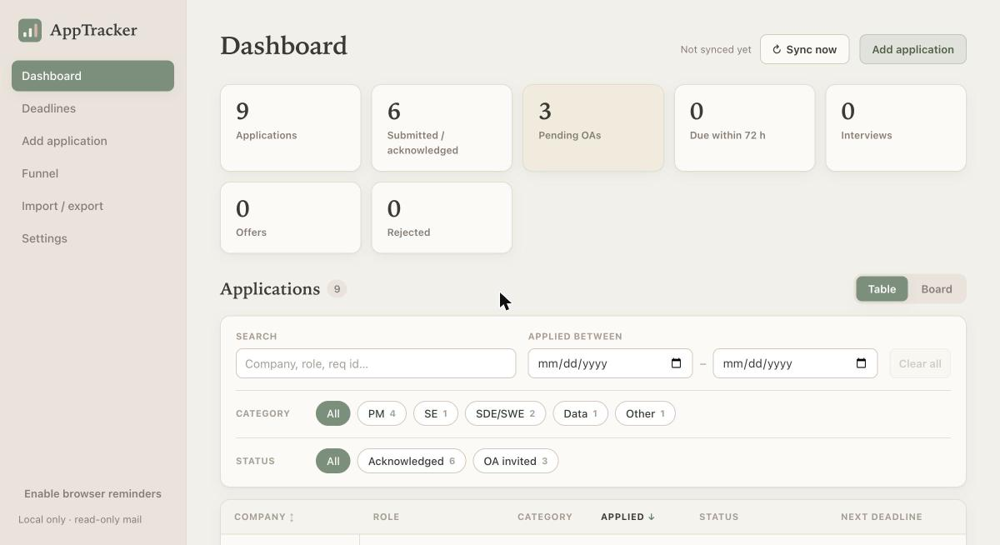
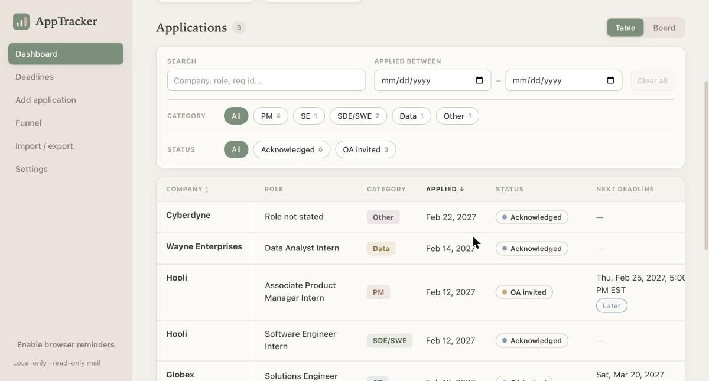
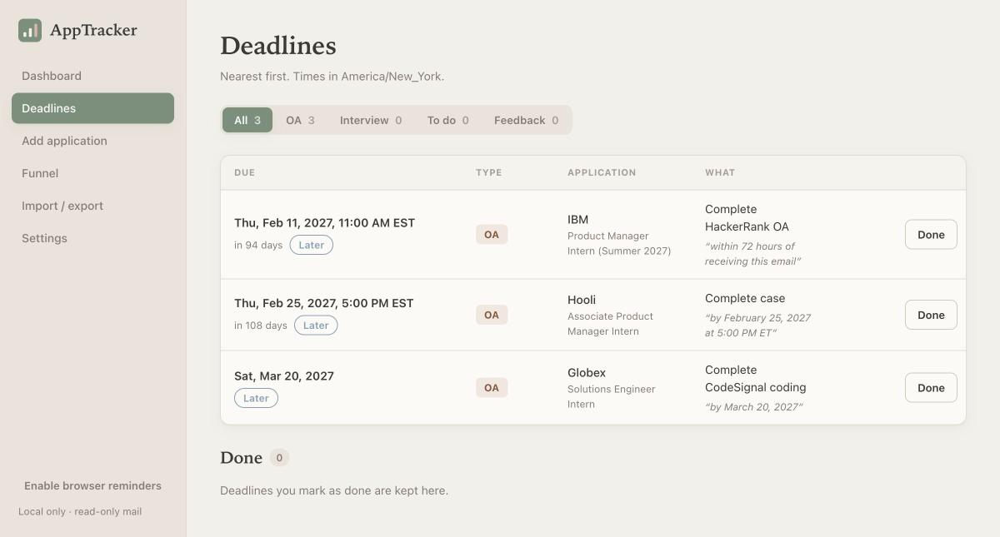

<h1 align="center">OfferRadar</h1>

<p align="center">
  <strong>Your inbox, turned into a private job-hunt dashboard.</strong><br/>
  Every application, online assessment, interview and rejection, found for you by a local AI.<br/>
  No spreadsheets. No cloud. No email ever leaves your laptop.
</p>

<p align="center">
  
  
  
  
</p>

<p align="center">
  
</p>

---

## Why OfferRadar?

Applying to 50+ internships or jobs means 50+ confirmation emails, a dozen OA links with
"complete within 72 hours", and rejections buried in Promotions. Keeping a spreadsheet in sync
by hand is a second job.

OfferRadar connects to your mailbox **read-only**, picks out the emails that are actually about
your applications, and keeps a dashboard up to date for you:

- **Applied?** Every confirmation ("Thanks for applying…") becomes a row: company, exact role, req ID, date.
- **What's due?** OA and interview deadlines are pulled out of the email, in the email's own words, sorted nearest first.
- **Where do I stand?** Statuses move forward on their own: Applied → OA invited → Interview → Offer / Rejected.
- **Private by design.** A small model (Qwen3-4B) runs on your machine through [Ollama](https://ollama.com). Nothing is sent to OpenAI, Anthropic or anyone else.

## Features

| | |
| --- | --- |
| 📬 **Gmail + Outlook** | OAuth with read-only scopes (`gmail.readonly`, `Mail.Read`). The app can't send, delete, move or mark mail. |
| 🧠 **Local AI extraction** | Company, role, req ID, event type and deadline, extracted as strict JSON and checked against verbatim quotes from the email. |
| 🚦 **Smart filter** | Only mail from applicant-tracking systems (Workday, Greenhouse, Lever, Ashby…) or with real application wording reaches the model. Newsletters and job alerts are skipped. In one real mailbox, 344 emails came down to 77 model calls. |
| 🗂 **Grouped dashboard** | Roles grouped by company, filter by category (PM / SE / SDE-SWE / Data) and status, sort by company or by date. |
| ⏰ **Deadlines page** | OA, interview, to-do and "we'll get back to you by…" dates, one row each, nearest first, with a Done list. |
| 🧭 **Board view** | Kanban by stage; columns scroll on their own, so 40 "Submitted" cards never bury the page. |
| ✉️ **One click to the source** | Every row links to the email it came from. |
| ↶ **Recover** | Removed something by mistake? Undo it. |
| 🔁 **Duplicate guard** | Warns before you apply to the same opening twice. |

<p align="center">
  
  
</p>

<sub>Screenshots use the built-in synthetic demo data.</sub>

---

## Quick start (macOS, about 10 minutes)

You need Homebrew. Everything else is installed below.

**1. Install the tools**

```bash
brew install python@3.12 node ollama
```

**2. Get the code and install dependencies**

```bash
git clone https://github.com/Aimee51819/offerradar.git
cd offerradar
make setup PYTHON=python3.12
```

**3. Start the local model** (keep this terminal open)

```bash
ollama serve
```

In a new terminal, download the model (about 2.5 GB, one time):

```bash
ollama pull qwen3:4b-instruct-2507-q4_K_M
```

**4. Configure and check**

```bash
cp backend/.env.example backend/.env
make migrate
make check-ollama
```

**5. Try it with fake emails first** (no mailbox needed)

```bash
cd backend && DATA_DIR=./demo-data .venv/bin/python -m app.cli demo --reset
DATA_DIR=./demo-data .venv/bin/python -m app.cli apply-pending
cd ../frontend && npm run build && cd ../backend
DATA_DIR=./demo-data .venv/bin/uvicorn app.main:app --host 127.0.0.1 --port 8000
```

Open **http://localhost:8000**. You should see the dashboard above.

**6. Connect your real inbox**

1. Register a free OAuth app with Google or Microsoft. It takes about 5 minutes; the step-by-step checklist is in **[docs/SETUP_MACOS.md, section 4](docs/SETUP_MACOS.md#4-oauth-app-registration--consent-checklist-you)**.
2. Put the client ID in `backend/.env` (`GOOGLE_CLIENT_ID=…` or `MICROSOFT_CLIENT_ID=…`).
3. Start the app without `DATA_DIR`, so your real data is kept apart from the demo:

   ```bash
   cd backend && .venv/bin/uvicorn app.main:app --host 127.0.0.1 --port 8000
   ```

4. Open http://localhost:8000 → **Settings** → **Connect Gmail** / **Connect Outlook**, approve the read-only access, then press **Sync now** on the dashboard.

The first sync reads the last 60 days of mail. With the smart filter on, a few hundred emails take a few minutes on an M-series Mac.

> **Tip:** if your personal Outlook account can't open the Microsoft Entra portal, sign in at
> [portal.azure.com](https://portal.azure.com) first and search for **App registrations** there.
> Choose "Accounts in any organizational directory and personal Microsoft accounts".

---

## How it works

```
Mailbox (read-only OAuth)
   │  fetch last N days
   ▼
Local store (SQLite, encrypted tokens)
   │  smart filter: ATS sender or real application wording?   ── no ──► ignored, no model call
   ▼ yes
Qwen3-4B on Ollama (localhost) ──► strict JSON: company, role, req ID, events, deadline quote
   │  validate: every fact must be quoted from the email; rule backstop for missed
   │  "thanks for applying" / rejection wording
   ▼
Match to an existing application (req ID, thread, company + role) or create one
   ▼
Dashboard · Deadlines · Board
```

- Deadlines are computed by deterministic code from the quoted text ("within 72 hours of receiving this email"), never guessed by the model.
- Each email is matched to at most one application; an OA for one role never moves another role at the same company.
- Everything runs on `127.0.0.1`. The server refuses non-local clients.

More detail: [docs/ARCHITECTURE.md](docs/ARCHITECTURE.md).

## Accuracy

`make eval` scores your installed model on a synthetic corpus of 29 recruiting emails
(confirmations, OAs with tricky time zones, rejections, prompt injection, hackathon sign-ups,
job-board spam):

| Metric | Qwen3-4B-Instruct (q4_K_M) |
| --- | --- |
| Is this a job email? | 1.00 |
| Event precision / recall | 0.92 / 0.85 |
| Company + role | 0.96 |
| Deadline | 1.00 (0 invented times) |

## Development

```bash
make test        # backend (pytest) + frontend (vitest)
make eval        # model accuracy on the synthetic corpus (needs Ollama)
make dev         # API on 127.0.0.1:8000, hot-reload UI on http://localhost:5173
```

Interactive API docs: http://127.0.0.1:8000/docs

## Privacy and security

- Mail access is read-only. Tokens are encrypted at rest and never logged.
- Email text only goes to the model on your own machine. There is no cloud fallback and no telemetry.
- The server binds to `127.0.0.1` only. Don't expose it to the internet.
- Keep `backend/.env` and your data folder (`~/Library/Application Support/AppTracker`) out of git and cloud sync.

## Credits

OfferRadar is built on [liamgelfand/application-tracker](https://github.com/liamgelfand/application-tracker) (MIT).

## License

MIT. See [LICENSE](LICENSE).
