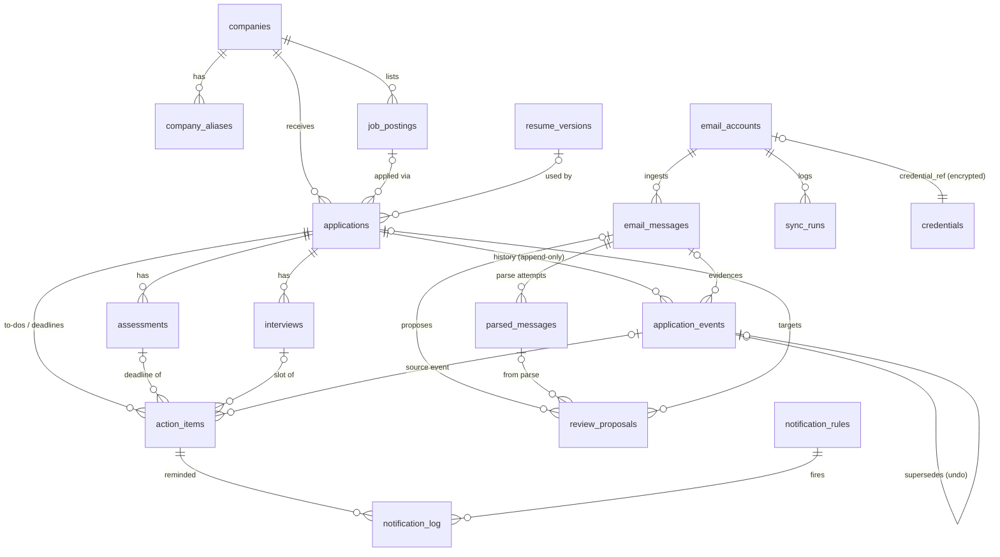

# Architecture

```
Gmail API (GET only) ─┐                       ┌─ deterministic: prefilter, req-id regex,
Graph API (GET only) ─┼─► ingest (idempotent) ─┤   deadline normalizer, resolver, policy
IMAP EXAMINE/PEEK ────┘   + encrypted body     └─ Qwen3-4B via Ollama (loopback): JSON only
                            cache                         │
                                                          ▼
                          parsed_messages (provenance) ─► plan ─► auto-apply (harmless, confident)
                                                                 └► review_proposals (default)
                                                                       │ approve/edit/reassign/reject/undo
                                                                       ▼
                         application_events (append-only) → applications.stage (summary)
                         assessments · interviews · action_items → reminders → dashboard
```

Code map (`backend/app`):

| Layer | Modules |
| --- | --- |
| Domain (pure, deterministic) | `domain/normalize.py`, `domain/deadlines.py`, `domain/resolver.py`, `domain/duplicates.py`, `domain/stages.py`, `domain/extraction_schema.py`, `domain/enums.py` |
| Mail (read-only) | `services/mail/{gmail,outlook,imap_client,oauth,http_readonly,fake,prefilter}.py` |
| Model | `services/llm/ollama.py` (only live backend), `services/llm/offline.py` (replay for tests/demo, regex baseline for eval) |
| Pipeline | `services/extraction/*`, `services/pipeline/{ingest,process,apply,review}.py`, `services/sync.py`, `services/notifications.py` |
| API | `api/*.py`, `schemas.py`, `api/deps.py` (local-only middleware, integration token) |
| Storage | `models.py`, `db.py`, `alembic/versions/0001_agent_schema.py` |

## Data model



Conventions: UUID string IDs; instants stored as UTC ISO-8601 text (`UTCDateTime`) and rendered in America/New_York; enum-like columns are TEXT validated in Python; `PRAGMA foreign_keys=ON`.

Key constraints and indexes: `email_messages(email_account_id, provider_message_id)` unique; `application_events.idempotency_key` unique; `applications.submission_idempotency_key` unique; `review_proposals.idempotency_key` unique; `notification_log(action_item_id, rule_id, scheduled_for_at)` unique; `company_aliases(company_id, normalized_alias, alias_type)` unique; indexes on `applications(stage, updated_at)`, `(company_id, normalized_role_title)`, `(external_job_id)`, `action_items(state, due_at)`, `email_messages(email_account_id, received_at)`, `review_proposals(state, created_at)`, plus every FK. There is deliberately **no** unique `(company, role)` constraint; duplicates are decided by the preflight.

Fields beyond the minimum spec: `applications.stage_evidence_at` (timestamp of the evidence behind the current stage, used to reject rollbacks from late-arriving mail), `action_items.due_date` (a day-precision deadline, stored without inventing a time), `application_events.supersedes_event_id` (undo/corrections), `email_messages.web_link` / `processing_attempts`, `review_proposals.idempotency_key` / `applied_event_ids`, `credentials` (encrypted token store), `notification_log.dismissed`.

**Migration.** `0001_agent_schema` detects the original tracker's schema, renames its tables to `legacy_*`, creates the new tables and copies applications, status history and IMAP accounts (disabled). `downgrade` drops the new tables and renames the legacy ones back. `init_db` takes a SQLite backup before any migration runs.

## Extraction contract (schema 1.0, prompt `2026-11-05.1`)

The model returns exactly this JSON (Ollama structured outputs with `format=<JSON schema>`, temperature 0, `top_k` 1, fixed seed). It is validated by `domain/extraction_schema.py::Extraction`, with one bounded retry that feeds back the validation errors. If validation still fails, the error is recorded in `parsed_messages.validation_errors` and nothing else changes.

```json
{
  "schema_version": "1.0",
  "is_job_related": true,
  "language": "en",
  "company": {"name": "Example Corp", "domain": null, "confidence": 0.98},
  "role": {"title": "Product Manager Intern", "requisition_id": "JR-123", "job_url": null, "confidence": 0.91},
  "events": [{
    "type": "assessment_invitation",
    "event_time": null, "event_time_raw": null,
    "action_required": "Complete the online assessment",
    "assessment_type": "OA", "assessment_provider": null, "action_url": null,
    "deadline": {"raw_expression": "within 72 hours of receiving this email", "kind": "relative",
                 "anchor": "email_received_at", "timezone_text": null, "date_only": null,
                 "normalized_at_utc": null, "precision": "relative", "assumptions": [], "confidence": 0.95},
    "evidence_quotes": ["within 72 hours of receiving this email"],
    "confidence": 0.95
  }],
  "overall_confidence": 0.94,
  "ambiguities": [],
  "needs_review": false
}
```

Event types: `application_confirmation`, `application_received`, `assessment_invitation`, `assessment_reminder`, `assessment_completed`, `screening`, `interview_invitation`, `interview_rescheduled`, `interview_cancelled`, `rejection`, `offer`, `withdrawal`, `portal_update`, `job_alert`, `other`. An email can carry up to 8 events.

Post-validation checks (deterministic, in `extractor.py`):

- Every evidence quote must appear verbatim in the subject or body. Unsupported quotes are dropped, and an event left without evidence is capped at 0.5 confidence and sent to review.
- The deadline `raw_expression` must appear verbatim in the email, or the deadline goes to review.
- The requisition ID must appear in the email. If the model omitted it and the regex finds exactly one, the regex value is used; if the regex finds several, the message goes to review.
- The company and role must be named in the email or sender, or confidence drops and the message goes to review.
- A job-alert/newsletter that the model calls a submission goes to review.
- `normalized_at_utc` from the model is **ignored**; `domain/deadlines.py` recomputes every deadline.
- OTP/verification mail, and blocked-sender mail with no recruiting vocabulary, is skipped before the model is called.
- Email text is delimited as `<email>…</email>`, control characters are stripped, it's truncated to `MAX_MODEL_INPUT_CHARS`, and anything resembling the delimiters is neutralized. The model has no tools, and nothing it outputs is executed.

## Deadline normalization rules

| Wording | Result |
| --- | --- |
| `within 72 hours of receiving this email` | provider received timestamp + 72 h elapsed (DST-correct), precision `relative`, anchor recorded |
| `within 3 days` | 3 calendar days at the same Eastern clock time; if a DST change falls inside, the 72-elapsed-hour alternative is disclosed |
| `… of when it was sent` | anchored on the sent time |
| `within 90 minutes once you begin` | a time limit, not a deadline: no due time, review |
| `by March 20, 2027` | `due_date=2027-03-20`, precision `day`, **no time and no UTC instant** |
| `by 5 PM on March 18` (no zone) | date kept, **no instant**, review |
| `11:59 PM ET` / `PT` / `UTC` / `+05:30` / IANA name | instant in UTC; `EST` written during EDT is disclosed and the real offset used |
| `2:30 AM` on a spring-forward day; `1:30 AM` on a fall-back day | nonexistent / ambiguous local time: no instant, review |
| `midnight` | read as the end of the stated day, flagged as ambiguous, review |
| `three business days` | weekends skipped, the date kept as day precision, US federal holidays in the window listed, **always review** |
| `by Friday`, `today`, `tomorrow` | resolved against the received date, review |
| Year missing | inferred from the email date and disclosed |

## Matching, confirmation and transition policy

1. **Company resolution** uses an exact normalized name, then a name alias (a verified alias resolves; an alias pointing at more than one company is ambiguous and never resolves). A domain alias counts only if it is verified and not a shared ATS, assessment, job-board or webmail domain.
2. **Candidate scoring** within that company: requisition match +0.6 (a conflicting requisition **disqualifies** the candidate); canonical URL +0.5; title similarity ≥0.92 +0.55, ≥0.75 +0.3, <0.5 −0.3; earlier approved evidence from the same thread +0.3. Auto-match needs a score ≥0.85, a 0.25 margin over the runner-up, and role or requisition evidence. Company-only evidence always goes to **review**.
3. **No match** → a `create_application` proposal. Approving an acknowledgment creates a *verified* application (`acknowledgment_email`). Approving any other event creates an *unverified* record. A job alert never creates one.
4. **Stage** (`domain/stages.py`): older evidence than the current stage's evidence → history only; going backwards (e.g. an OA after an interview) → history only; terminal targets, changes out of a terminal stage, and pinned stages → review. The application's own `stage` is only a summary; the events, assessments and interviews all remain.
5. **Routing** (`apply.route_plan`). Auto-apply happens only when all of these hold: the `auto_harmless` policy is on, the match is automatic, no deadline conflict, no sensitive event type, no stage decision needing review, no flags, and confidence ≥ the threshold. Everything else becomes one review proposal per message.
6. **Reminder conflicts**: a reminder whose deadline differs from the one on file becomes a `deadline` proposal. On approval you choose `use_new` (the old item is cancelled, not deleted) or `keep_existing`.
7. **Undo** writes `undo` events that supersede the originals, restores the previous stage if nothing newer changed it, cancels any items it created, clears acknowledgment-derived submission evidence, and returns the proposal to pending with its original target.

## Duplicate preflight

`POST /api/duplicates/check` (also run automatically on manual add, CSV import and integration submissions):

- **BLOCK** — same requisition ID or same canonical posting URL, in the same or an unspecified cycle.
- **WARN** — another role at the same employer; the same title without IDs ("probably the same opening"; imports skip these unless overridden); the same title with a different requisition; the same opening in another cycle while still active.
- **ALLOW** — nothing comparable, or the same requisition reopened in a different cycle after the earlier one closed.

An override needs a reason and writes a `duplicate_override` event.

## Integration endpoint

Requires `Authorization: Bearer <token>` (`python -m app.cli integration-token`), from loopback.

```http
POST /api/integrations/preflight
{"company": "IBM", "role_title": "Product Manager Intern", "external_job_id": "84211", "recruiting_cycle": "Summer 2027"}
→ {"decision": "BLOCK", "reasons": [...], "matches": [...]}

POST /api/integrations/submissions
{"source": "career-ops", "idempotency_key": "…unique…", "confirmed": true, "receipt_id": "CONF-77",
 "company": "…", "role_title": "…", "external_job_id": "…", "posting_url": "…",
 "recruiting_cycle": "Summer 2027", "submitted_at": "2026-10-20T15:00:00Z", "resume_label": "PM 2027"}
→ {"application_id": "…", "created": true, "duplicate_check": {...}}
```

`confirmed` must be `true` and `receipt_id` is required. A click attempt or a queued draft is not a submission. Replaying the same `idempotency_key` returns the same application; an exact-opening duplicate returns `409`; a tracked-but-unsubmitted record of the same opening is upgraded in place. A future `submitted_at` returns `422`.

## REST endpoints

Applications and records: `GET/POST /api/applications` (filters: `q`, `company`, `role`, `category`, `stage`, `source`, `resume_version_id`, `submitted_from`, `submitted_to`, `urgency`, `needs_review`, `verified`) · `GET/PATCH /api/applications/{id}` · `POST /api/applications/{id}/stage` (`{stage, note, lock}`) · `POST /api/applications/{id}/notes` · `GET /api/applications/{id}/events` · `GET /api/events` · `POST /api/duplicates/check` · `GET /api/companies` · `GET/POST /api/companies/{id}/aliases` · `GET/POST /api/postings` · `GET/POST /api/resumes` · `GET /api/action-items` · `POST /api/action-items/{id}` (edit due / state) · `POST /api/assessments/{id}/complete`

Dashboard: `GET /api/dashboard/{summary,deadlines,changes,funnel,digest,notifications}` · `POST /api/dashboard/notifications/{id}/dismiss`

Review: `GET /api/reviews?state=pending|approved|edited|rejected` · `GET /api/reviews/{id}` · `POST /api/reviews/{id}/approve` (`{target_application_id?, create_new?, edits?, notes?}`) · `POST /api/reviews/{id}/reject` · `POST /api/reviews/{id}/undo`

Mail and sync: `GET /api/accounts` · `PATCH /api/accounts/{id}` · `DELETE /api/accounts/{id}` (disconnect + revoke) · `POST /api/accounts/imap` · `GET /api/oauth/{gmail|outlook}/start` · OAuth callbacks · `GET /api/sync/status` · `GET /api/sync/runs` · `POST /api/sync/run` · `POST /api/sync/fetch-only?account_id=` · `POST /api/sync/dry-run`

Settings: `GET/PUT /api/settings` · `GET/PUT /api/notification-rules` · `GET /api/llm/health` · `GET /api/integrations/token-hint`

Import/export: `POST /api/import/csv` (multipart: `file`, `dry_run`, `override_rows`) · `GET /api/export/applications.csv` · `GET /api/export/json` · `GET /api/export/deadlines.ics` · `GET /api/backup` · `POST /api/backup/restore`

Integrations: `POST /api/integrations/preflight` · `POST /api/integrations/submissions`

Health: `GET /api/health` · `GET /api/identity` · interactive docs at `/docs`.

## Evaluation (synthetic corpus, 24 messages, 25 events, 12 deadlines)

`python -m app.cli eval --backend <ollama|rules|replay>` reports event-classification precision/recall (micro and per type), is-job-related accuracy, company+role accuracy, requisition accuracy, deadline accuracy, and the count of fabricated deadline instants.

| Backend | Event P / R | Job-related acc. | Company+role acc. | Req. acc. | Deadline acc. | Fabricated instants |
| --- | --- | --- | --- | --- | --- | --- |
| `replay` (hand-written gold; checks the harness and normalizer) | 1.00 / 1.00 | 1.00 | 1.00 | 1.00 | 1.00 | 0 |
| `rules` (regex baseline, no LLM) | 0.91 / 0.84 | 0.92 | 0.82 | 1.00 | 0.50 | 0 |
| `ollama` Qwen3-4B-Instruct-2507 | **not measured yet** — Ollama was not available in the build environment. Run `make eval` on the Mac. | | | | | |

The corpus is small and synthetic, so treat these numbers as regression signals rather than real-world accuracy.

## Known limitations

- The Qwen accuracy above is unmeasured until you run `make eval` locally. The design assumes the model can be wrong; that's why evidence checks and review-first are the defaults.
- The fixture corpus is English-only and covers 24 scenarios; real ATS mail is more varied. Add anonymized fixtures to `tests/fixtures/generate_fixtures.py` as you encounter new formats.
- Business-day deadlines always need human confirmation; employer holiday calendars aren't knowable.
- Gmail OAuth in Google's "Testing" mode needs reconnecting every 7 days.
- Microsoft tenant policies (for example a university Microsoft 365) may block `Mail.Read` consent without admin approval.
- Job-posting records (`job_postings`) are created manually; there is no web scraping.
- Single user. No authentication layer, so it is not for remote hosting.
- The upstream Windows auto-updater is kept but points at the upstream repository's releases. Leave it unused, or repoint `GITHUB_REPO` in `app/version.py` to your fork.
